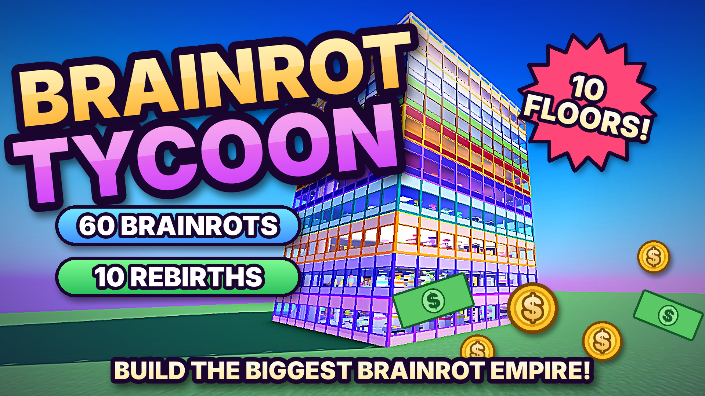
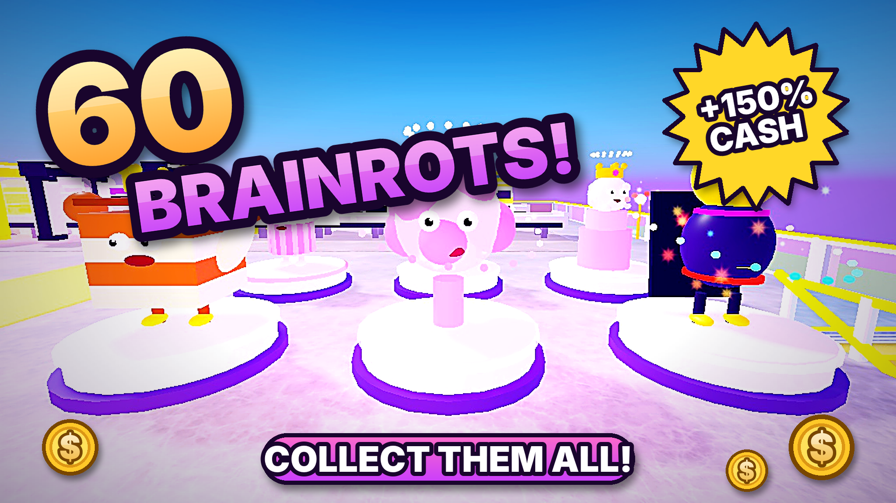
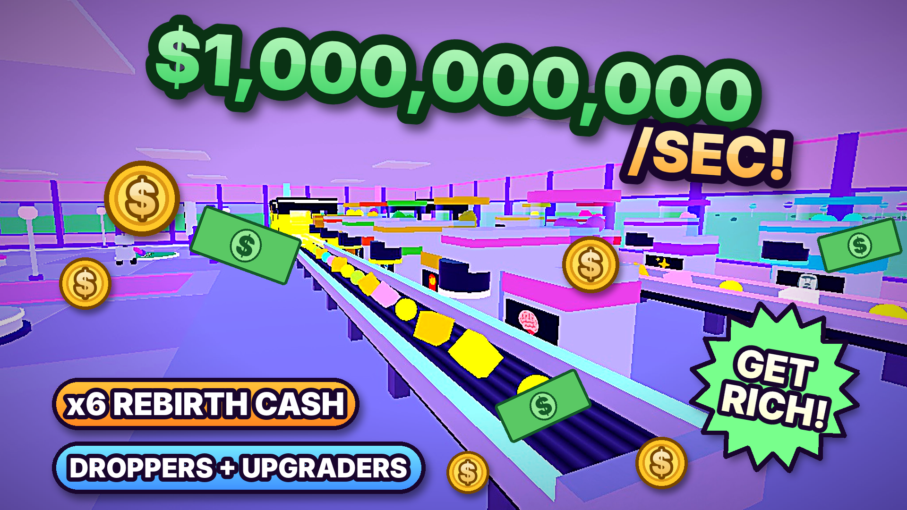

# Brainrot Tycoon



Tycoon de Roblox com tema "Italian brainrot": cada jogador recebe uma base de 10 andares e compra droppers, esteiras, upgraders, móveis e 60 brainrots que aumentam a renda.

- **Jogar:** https://www.roblox.com/games/98103613172246/Brainrot-Tycoon
- **Idioma do jogo:** inglês
- **Jogadores por servidor:** 6 (uma base para cada)

## Funcionalidades

- **10 andares por base:** Térreo, 2º e 3º andar, Laboratório, Cobertura Celestial, Cassino, Selva Tropical, Estação Espacial, Templo Antigo e Trono Supremo. São 272 itens no total.
- **10 rebirths:** cada um dá +50% de renda permanente (x6 no máximo) e libera andares, armas e skins novas.
- **60 brainrots:** somam até +150% de renda nos droppers, mas só com tudo comprado no Rebirth 10.
- **Níveis de dropper:** o jogador melhora um dropper apertando **F** perto dele. O nível máximo vai de 3 até 8 conforme os rebirths.
- **11 armas e 12 skins brainrot:** compradas com dinheiro do jogo e permanentes. A praça central é zona segura, sem combate.
- **3 leaderboards globais** na praça: tempo jogado, dinheiro total gerado e Robux gastos.
- **Ganhos offline:** 25% da renda por até 2h, ou 100% por até 12h com o Game Pass.
- **Progressão estimada:** cerca de 112 horas para um jogador grátis completar tudo (detalhes em [docs/Brainrot_Tycoon_Rebirth.pdf](docs/Brainrot_Tycoon_Rebirth.pdf)).

## Itens com Robux

| Tipo | Item | Preço |
|---|---|---|
| Game Pass | 2x Cash | R$ 199 |
| Game Pass | VIP Auto-Collector | R$ 99 |
| Game Pass | VIP Offline Earnings | R$ 149 |
| Game Pass | Turbo Sneakers | R$ 79 |
| Dev Product | VIP Dropper (1 por andar, ~6x o melhor dropper) | R$ 29 a 199 |
| Dev Product | VIP Upgrader x3 (1 por andar) | R$ 25 a 189 |
| Dev Product | 5 min / 30 min / 1 h / 6 h / 12 h de renda | R$ 5 / 30 / 60 / 300 / 600 |

Os IDs dos Game Passes e Developer Products ficam em `Config.GamePasses`, `Config.VipProductIds` e `Config.CashPacks`. Com ID `0`, a compra só funciona no Studio, em modo de teste.

## Estrutura do código

```
src/
├── ReplicatedStorage/Shared/
│   ├── Config.luau          -- toda a economia, andares, itens, armas, skins, Robux
│   └── Format.luau          -- formatação de dinheiro ($1.2M, $3.4Qa...)
├── ServerScriptService/TycoonServer/
│   ├── Main.server.luau     -- liga jogadores, terrenos, rebirth, ganhos offline
│   ├── Tycoon.luau          -- lógica de cada base (botões, minérios, cofre, níveis)
│   ├── DataService.luau     -- salvamento (DataStore "BrainrotTycoon_v2")
│   ├── Arsenal.luau         -- loja, armas, skins e combate
│   ├── Monetization.luau    -- Game Passes e Developer Products
│   └── Leaderboards.luau    -- placares globais (OrderedDataStore)
├── ServerStorage/
│   ├── PlotBuilder.luau     -- gera a geometria da base (usado no Studio)
│   ├── BuildTools.luau      -- modelagem procedural dos brainrots
│   └── LEIA_ME.luau
└── StarterPlayer/StarterPlayerScripts/TycoonClient/
    ├── init.client.luau     -- inicia o cliente
    ├── Hud.luau             -- HUD, rebirth, notificações
    ├── WorldFx.luau         -- efeitos visuais, guia, popups
    ├── Shop.luau            -- loja (armas, skins, Robux)
    └── Combat.luau          -- efeitos das armas
```

O layout segue o padrão do [Rojo](https://rojo.space). Os modelos 3D, como a base (`TycoonTemplate`), os brainrots, as armas, as skins, o mapa e a interface (`TycoonHUD`), não são scripts: estão no arquivo do jogo completo, [`BrainrotTycoon.rbxl`](BrainrotTycoon.rbxl). Para abrir, use o Roblox Studio em **Arquivo → Abrir do arquivo**.

## Capas

| | | |
|---|---|---|
|  |  |  |
